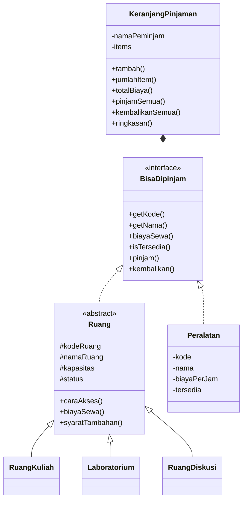

# Tugas 5 - Advanced OOP

Mini application OOP untuk kasus **Sistem Peminjaman Ruang Kelas**, melanjutkan
class `RuangKelas` dari Tugas 3 dan Tugas 4.

Mata kuliah: Pemrograman Berorientasi Objek (TI033015)
Program studi: Teknik Informatika, Universitas Catur Insan Cendekia
Penyusun: Muhammad Arif Triyana (20251020011)

## Masalah

Kampus memiliki beberapa jenis ruang dengan aturan yang tidak sama. Ruang kuliah
diajukan lewat bagian akademik, laboratorium diajukan lewat kepala laboratorium
dan wajib didampingi laboran, sedangkan ruang diskusi dipesan sendiri lewat
aplikasi kampus. Tarif per jamnya juga berbeda. Selain ruang, mahasiswa sering
meminjam peralatan seperti proyektor dan laptop pada waktu yang bersamaan.

Program sebelumnya hanya memiliki satu class `RuangKelas`, sehingga semua ruang
dianggap sama. Akibatnya aturan dan tarif harus ditulis sebagai percabangan di
kode pemanggil, dan setiap kali muncul jenis ruang baru kode pemanggil ikut
diubah. Tugas ini menyusun ulang model tersebut supaya jenis objek baru dapat
ditambahkan tanpa menyentuh kode pemanggil.

## Desain



| Class | Peran |
| --- | --- |
| `BisaDipinjam` | Interface. Kontrak untuk apa pun yang dapat dipinjam. |
| `Ruang` | Abstract class. Menyimpan kode, nama, kapasitas, status, dan aturan pinjam/kembali yang sama untuk semua ruang. |
| `RuangKuliah` | Ruang untuk perkuliahan, tarif Rp50.000 per jam. |
| `Laboratorium` | Ruang praktikum, tarif Rp120.000 per jam, punya syarat tambahan. |
| `RuangDiskusi` | Ruang diskusi mahasiswa, tarif Rp25.000 per jam. |
| `Peralatan` | Barang yang dipinjam bersama ruang, misalnya proyektor dan laptop. |
| `KeranjangPinjaman` | Wadah yang menyusun beberapa item menjadi satu pengajuan peminjaman. |

## Alasan pilihan relasi

1. **Inheritance dipakai untuk jenis ruang.** `RuangKuliah`, `Laboratorium`, dan
   `RuangDiskusi` benar-benar "adalah" sebuah `Ruang`. Ketiganya memakai kode,
   nama, kapasitas, status, dan aturan pinjam/kembali yang identik. Yang berbeda
   hanya cara akses dan tarif. Karena hubungannya is-a dan perilaku dasarnya
   memang layak dipakai ulang, inheritance adalah pilihan yang tepat. Inheritance
   tidak dipakai semata-mata untuk menghindari duplikasi beberapa baris kode.

2. **Interface dipakai untuk kemampuan meminjam.** Proyektor bukan ruang, jadi
   tidak mungkin mewarisi `Ruang`. Yang sama antara ruang dan peralatan bukan
   strukturnya, melainkan kemampuannya, yaitu bisa dipinjam, punya kode, dan
   punya tarif. Hubungan seperti ini adalah can-do, sehingga bentuk yang benar
   adalah interface. Karena `KeranjangPinjaman` menerima `BisaDipinjam`, keranjang
   dapat menampung ruang dan peralatan sekaligus tanpa memeriksa class-nya.

3. **Composition dipakai untuk keranjang.** `KeranjangPinjaman` bukan salah satu
   jenis `BisaDipinjam`, melainkan wadah yang berisi banyak item. Hubungannya
   has-a. Composition dipilih karena isi keranjang harus dapat ditambah dan
   diganti saat program berjalan, dan keranjang tidak perlu mewarisi apa pun dari
   item yang disimpannya.

4. **Kenapa tidak semuanya inheritance.** Bila `Peralatan` dipaksa
   `extends Ruang`, ia akan menerima kapasitas dan cara akses yang tidak masuk
   akal untuk sebuah proyektor. Bila `KeranjangPinjaman` mewarisi item, keranjang
   justru menjadi salah satu item, padahal tugasnya menyimpan item.

## Overriding dan polymorphism

`caraAkses()` dan `biayaSewa()` dideklarasikan abstract pada `Ruang`, sehingga
setiap subclass wajib memberi implementasi sendiri. `syaratTambahan()` berbeda:
method ini sudah punya isi default berupa array kosong, dan hanya `Laboratorium`
yang meng-override-nya. Dua bentuk ini sengaja ditunjukkan bersama supaya
terlihat bedanya antara method yang wajib diwujudkan dan method yang boleh
diwarisi apa adanya.

Polymorphism muncul di dua tempat. `cetakTarif(BisaDipinjam $item)` memanggil
`biayaSewa()` pada lima objek dari dua hierarki berbeda dan hasilnya menyesuaikan
masing-masing objek. `cetakCaraAkses(Ruang $ruang)` memanggil `caraAkses()` pada
tiga jenis ruang. Keduanya tidak memuat satu pun `if` yang memeriksa nama class.

## Cara menjalankan

```bash
php index.php
```

Program tidak memerlukan database, Composer, atau pustaka tambahan. Cukup PHP 7.4
ke atas karena kode memakai typed property.

## Hasil pengujian

Keluaran program dibagi menjadi enam bagian:

| Bagian | Yang dibuktikan |
| --- | --- |
| 1 | Aturan tiap jenis ruang berbeda, termasuk syarat tambahan laboratorium. |
| 2 | Satu fungsi `cetakTarif()` menghasilkan tarif berbeda untuk lima objek. |
| 3 | Satu fungsi `cetakCaraAkses()` menghasilkan cara akses berbeda untuk tiga jenis ruang. |
| 4 | Keranjang menampung tiga item berbeda dan menghitung total tarifnya. |
| 5 | Penolakan berjalan: item ganda, pinjam dua kali, kembalikan saat tersedia, kode kosong, biaya nol, dan nama peminjam kosong. |
| 6 | Keadaan akhir: tiga item, total Rp90.000 per jam, semuanya tersedia. |

## Struktur berkas

```
index.php                    demo dan pengujian
src/BisaDipinjam.php         interface
src/Ruang.php                abstract class
src/RuangKuliah.php          subclass
src/Laboratorium.php         subclass
src/RuangDiskusi.php         subclass
src/Peralatan.php            implementasi interface di luar hierarki Ruang
src/KeranjangPinjaman.php    composition
README.md                    berkas ini
REFLEKSI.md                  refleksi pengerjaan
```
