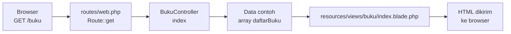
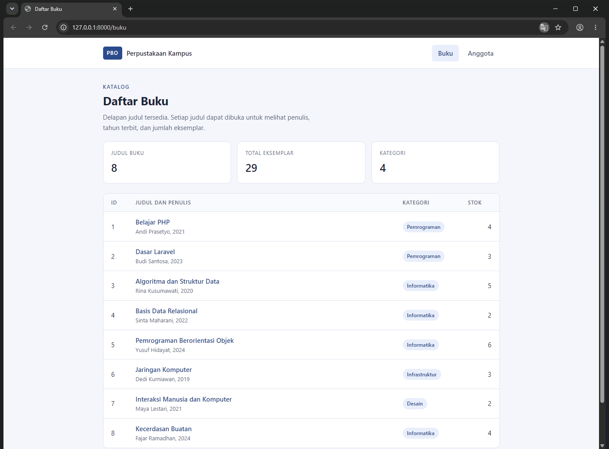
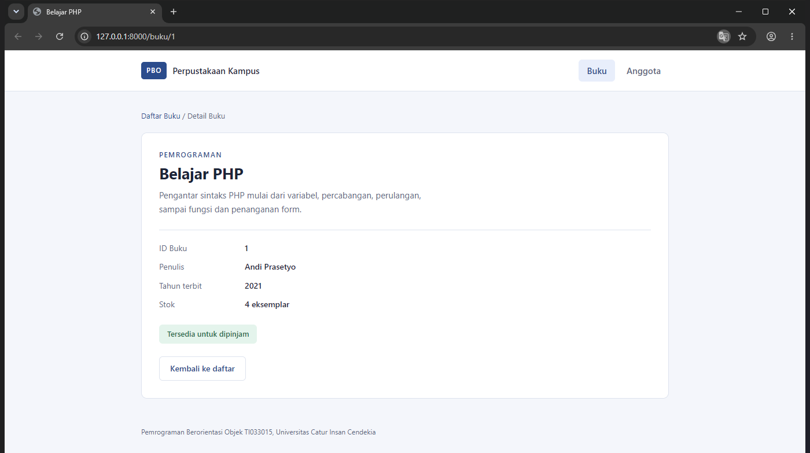
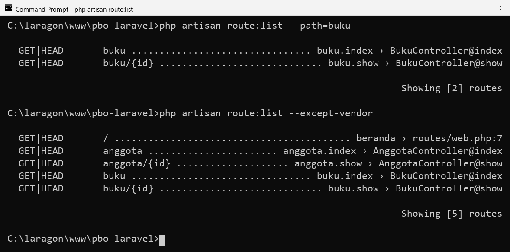
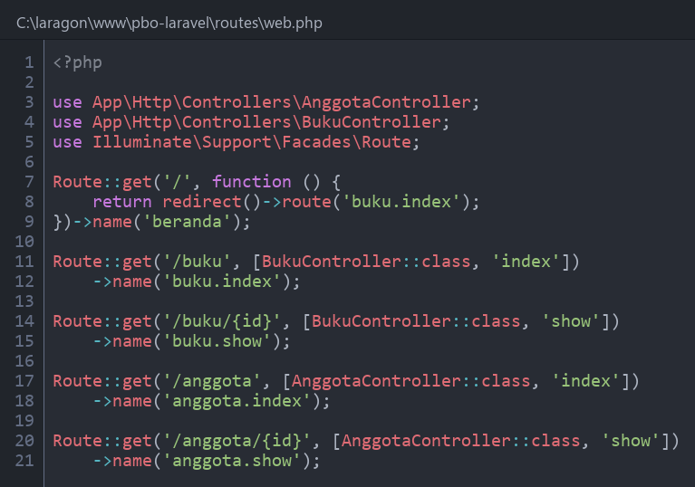
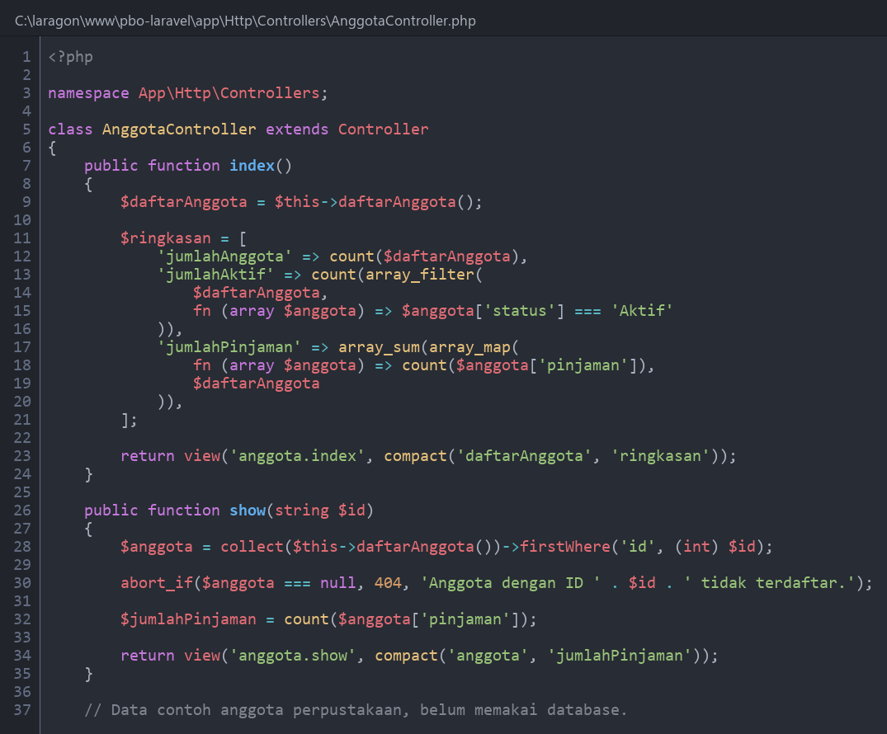
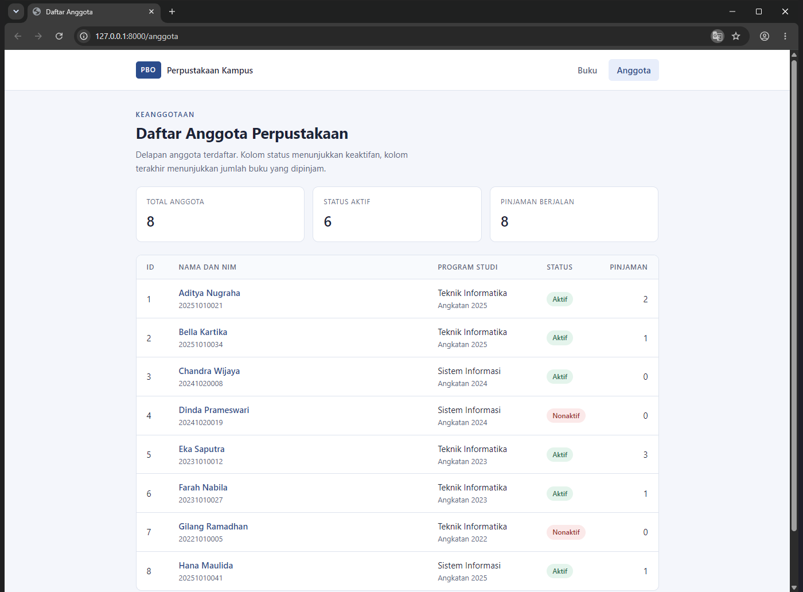
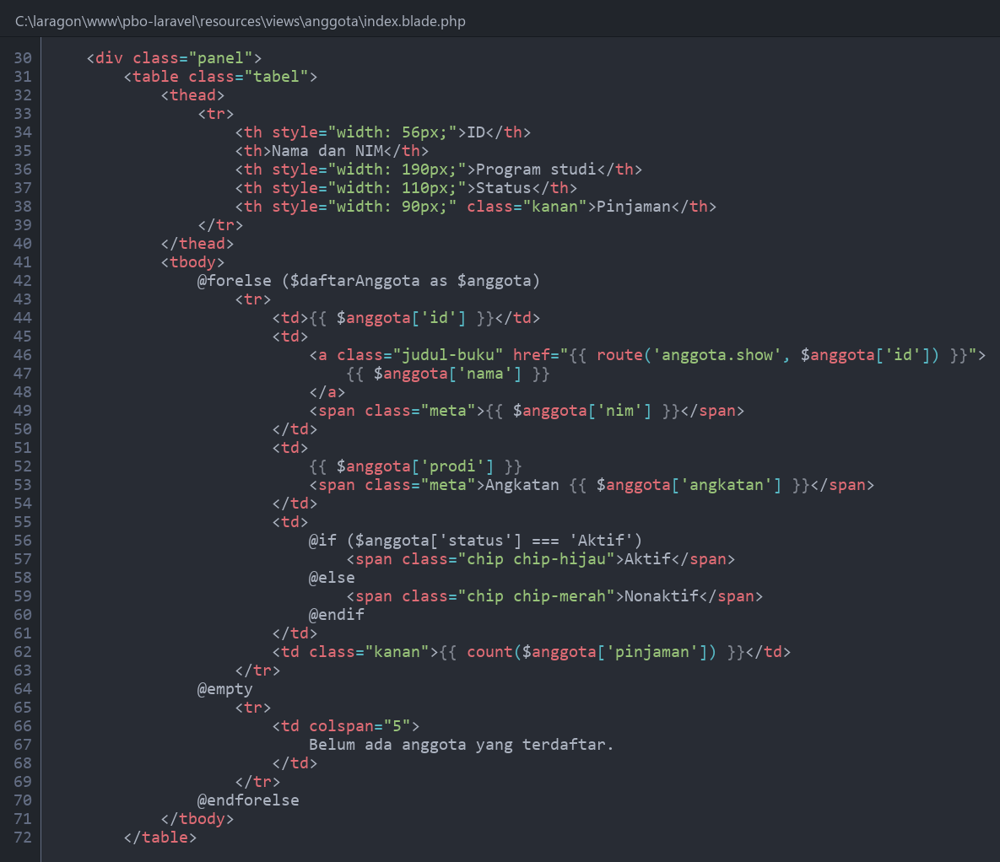
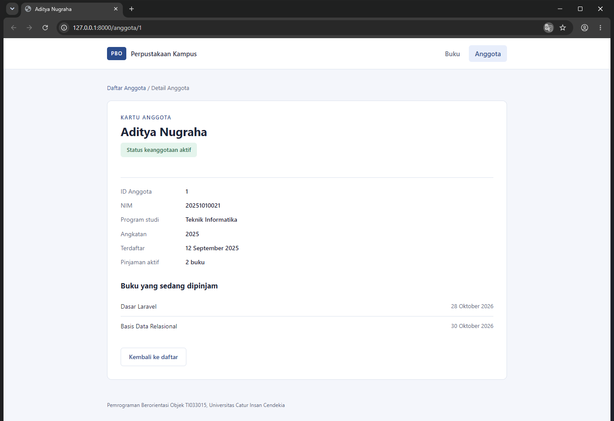
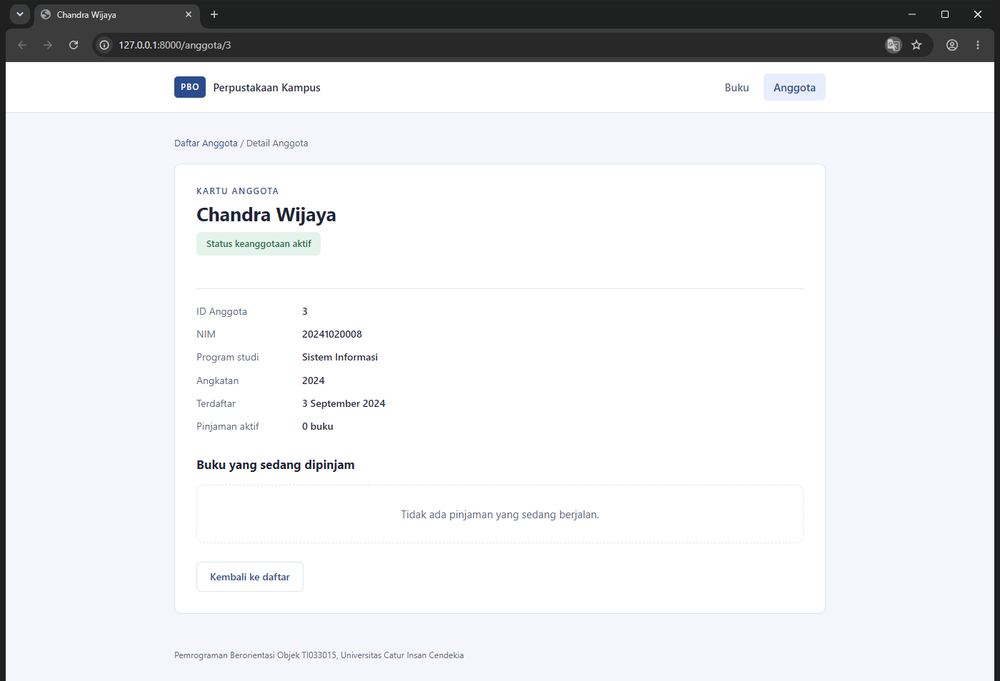

# Tugas 7 — Routing, Controller & Blade

Praktikum dan tugas rumah individu mata kuliah **Pemrograman Berorientasi Objek (TI033015)**,
Program Studi Teknik Informatika, Universitas Catur Insan Cendekia.

Proyek ini melanjutkan proyek Laravel dari Pertemuan 6. Data masih berupa array contoh
yang disiapkan di Controller, belum memakai database, sesuai arahan modul Pertemuan 7.

## Isi branch

| Bagian | Isi |
| --- | --- |
| Praktikum | Halaman `/buku` dan `/buku/{id}` |
| Tugas rumah | Halaman `/anggota` dan `/anggota/{id}` |

## Daftar route

| Method | URI | Action | Nama route | Keterangan |
| --- | --- | --- | --- | --- |
| GET | `/` | closure | `beranda` | Mengalihkan ke daftar buku |
| GET | `/buku` | `BukuController@index` | `buku.index` | Daftar buku |
| GET | `/buku/{id}` | `BukuController@show` | `buku.show` | Detail satu buku |
| GET | `/anggota` | `AnggotaController@index` | `anggota.index` | Daftar anggota |
| GET | `/anggota/{id}` | `AnggotaController@show` | `anggota.show` | Detail satu anggota |

## Alur Route ke Controller ke Blade



1. Peramban meminta `GET /buku`.
2. `routes/web.php` mencocokkan URI tersebut dengan `BukuController@index`.
3. Controller menyiapkan `$daftarBuku` dan `$ringkasan`, lalu memanggil `view()`.
4. Blade merender `buku/index.blade.php` memakai `@foreach` dan `@if`, hasilnya HTML.

## Struktur berkas yang ditambahkan

```
app/Http/Controllers/BukuController.php
app/Http/Controllers/AnggotaController.php
resources/views/layouts/app.blade.php
resources/views/buku/index.blade.php
resources/views/buku/show.blade.php
resources/views/anggota/index.blade.php
resources/views/anggota/show.blade.php
public/css/pbo.css
routes/web.php
```

## Directive Blade yang dipakai

| Directive | Letak | Fungsi |
| --- | --- | --- |
| `@extends` / `@section` / `@yield` | layout dan semua halaman | Satu kerangka untuk banyak halaman |
| `@foreach` | `buku/index`, `anggota/show` | Mengulang baris data |
| `@forelse` / `@empty` | `anggota/index` | Daftar dengan keadaan kosong |
| `@if` / `@else` / `@endif` | `buku/index`, `buku/show`, `anggota/index`, `anggota/show` | Percabangan tampilan |
| `{{ }}` | semua halaman | Menampilkan data dengan escape |

## Praktikum: halaman buku

### Halaman daftar buku



Delapan judul buku ditampilkan dengan `@foreach`, sedangkan tiga kartu ringkasan
di atasnya dihitung di `BukuController@index`.

### Halaman detail buku



Nilai `{id}` pada URL diterima method `show()`. Bila id tidak ada, `abort_if`
menghentikan permintaan dengan halaman 404.

### Pemeriksaan route dengan Artisan



`php artisan route:list --path=buku` memastikan kedua route praktikum terbaca
Laravel, lalu `--except-vendor` menampilkan seluruh route aplikasi.

## Tugas rumah: halaman anggota

### Berkas routes/web.php



### Berkas AnggotaController.php



### Halaman daftar anggota



Daftar anggota memakai `@forelse` dengan `@empty`, dan kolom status memilih
penanda hijau atau merah lewat `@if`.

### Berkas anggota/index.blade.php



### Detail anggota dengan pinjaman



### Detail anggota tanpa pinjaman



Dua gambar terakhir membuktikan kedua cabang `@if` pada daftar pinjaman
berjalan sesuai keadaan datanya.

## Cara menjalankan

```bash
composer install
cp .env.example .env
php artisan key:generate
php artisan serve
```

Buka `http://127.0.0.1:8000`, lalu pilih menu Buku atau Anggota.

Proyek ini tidak memerlukan database. Konfigurasi bawaan SQLite boleh dibiarkan apa adanya
karena tidak ada query yang dijalankan.

## Catatan

Data contoh diletakkan pada method privat di dalam Controller supaya `routes/web.php`
tetap ringkas. Ketika materi Eloquent dibahas pada minggu berikutnya, isi method tersebut
diganti dengan query model tanpa mengubah bentuk view.
